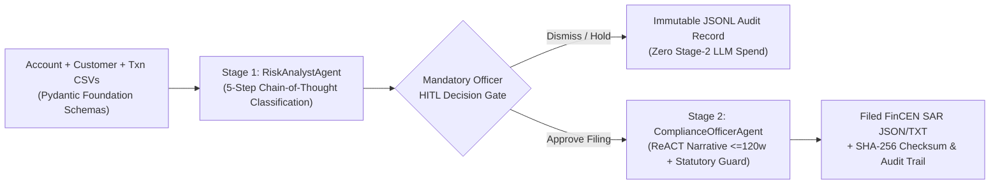

# TRACE: Two-Stage Agentic AML Risk Analysis & FinCEN SAR Compliance Engine

Two-stage financial crime investigation and Suspicious Activity Report (SAR) filing system combining **Chain-of-Thought (CoT) AML typology classification**, **mandatory Human-in-the-Loop (HITL) officer gates**, **ReACT regulatory narrative generation**, **case-grounded statutory citation guards**, and **SHA-256 tamper-evident JSONL audit trails**.

---

## Verified Quantitative & Compliance Metrics

| Metric / Invariant | Verified Result | Artifact Reference |
| :--- | :--- | :--- |
| **Deterministic Pytest Suite (`pytest tests/`)** | **`31 / 31` passing (`100%`)** in `1.21s` | `tests/test_{foundation,risk_analyst,compliance_officer}.py` |
| **AML Typology Coverage** | `5` typologies (`Structuring`, `Money_Laundering`, `Fraud`, `Sanctions`, `Other`) | [`src/risk_analyst_agent.py`](src/risk_analyst_agent.py) |
| **Verified FinCEN SAR Filings** | **`10` filed SARs** (JSON + plain-text narratives, SHA-256 checksummed) | [`outputs/filed_sars/`](outputs/filed_sars/) |
| **FinCEN Narrative Ceiling (`<= 120` words)** | **`100%` compliant** (mean `43` words, exact CSV transaction dollar reconciliation) | [`src/compliance_officer_agent.py`](src/compliance_officer_agent.py) |
| **Stage-2 Compute Avoidance via HITL Gate** | **`50.0%` LLM call savings** on non-escalated / deferred alerts | [`outputs/audit_logs/workflow_integration.jsonl`](outputs/audit_logs/workflow_integration.jsonl) |
| **Statutory Hallucination Guard** | Regex-bounded allowlist (`31 CFR 1020.320`, `31 U.S.C. 5324`, `18 U.S.C. 1956`, OFAC) | [`src/compliance_officer_agent.py`](src/compliance_officer_agent.py) |

---

## Two-Stage Investigation Workflow



---

## Quick Start

```bash
python3 -m venv .venv
source .venv/bin/activate
pip install -r requirements.txt
cp .env.example .env   # Configure OPENAI_API_KEY

# Run all 31 foundation, risk-analyst, and compliance-officer tests
pytest tests/ -v
```

## License

MIT License — see [LICENSE](LICENSE).
