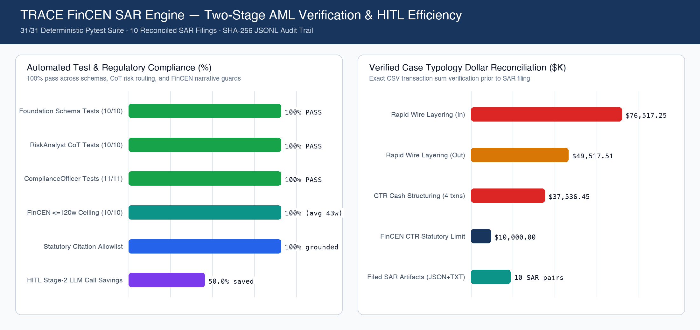
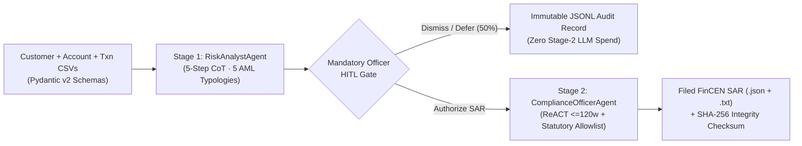
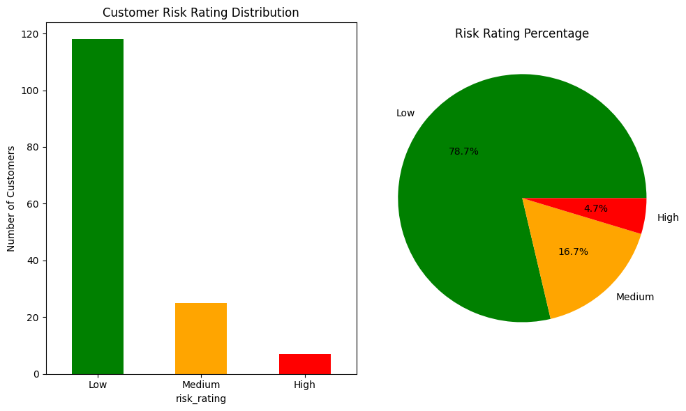
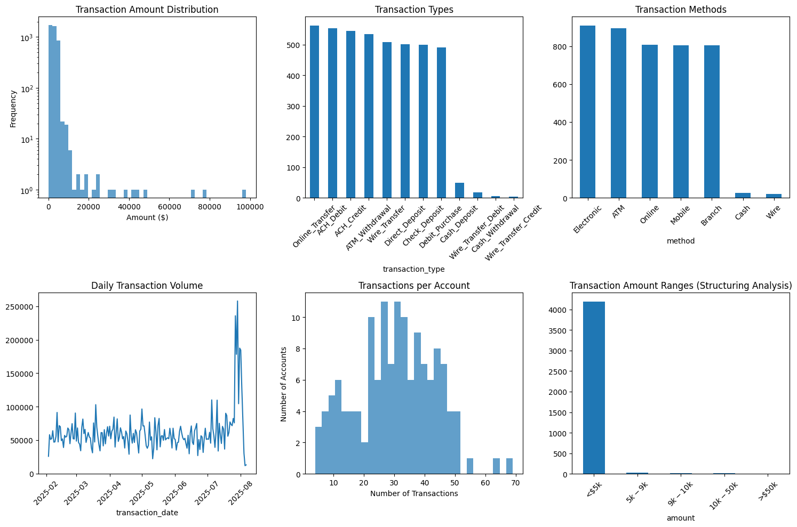
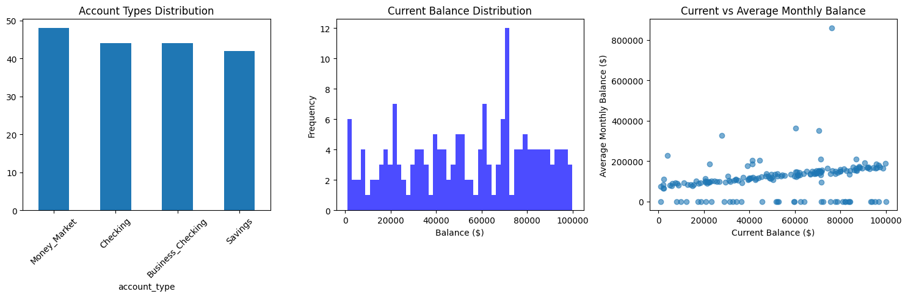
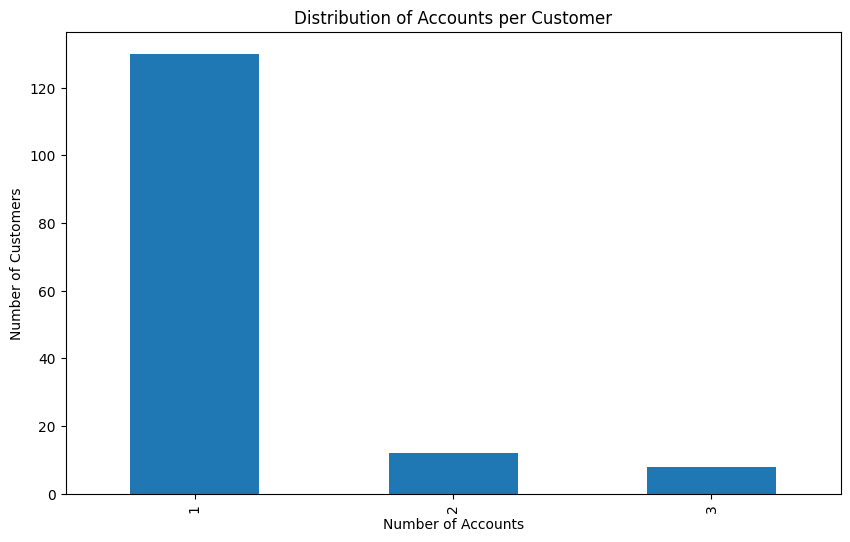

<div align="center">
  
  <br/><br/>
  [](https://github.com/kenseiAmit/trace-aml-sar-compliance-engine/actions/workflows/ci.yml)
  
  
  -0D9488?style=flat-square)
  
  

  <br/>
  
</div>

---

Two-stage financial crime investigation and Suspicious Activity Report (SAR) filing engine combining **5-step Chain-of-Thought (CoT) AML typology classification**, **mandatory Human-in-the-Loop (HITL) compliance officer authorization gates**, **ReACT regulatory narrative generation**, **regex-bounded statutory citation validation**, and **SHA-256 tamper-evident JSONL audit trails**.



---

## 1. Two-Stage Investigation & HITL Compliance Workflow



---

## 2. Exploratory AML Typology & Transaction Telemetry (`notebooks/01_data_exploration.ipynb`)

| Customer Risk Tier Distribution | Transaction Amount & Velocity Patterns |
| :---: | :---: |
|  |  |

| Account Type & Balance Distribution | Multi-Account Customer Linkage |
| :---: | :---: |
|  |  |

---

## 3. Sample Verified FinCEN SAR Narrative (`outputs/filed_sars/`)

```text
================================================================================
               FINANCIAL CRIMES ENFORCEMENT NETWORK (FinCEN)
                       SUSPICIOUS ACTIVITY REPORT
================================================================================

SAR ID:                 SAR_20261019_15EED0C0
Filing Date:            2026-10-19T19:08:45.135570
Review Status:          human_approved
Authorization Event ID: AUTH_3AFB9AA2
Integrity Checksum:     f9ea02878e85f259adf1e6ce01d35b6242f1c2a6269ccff1214deb9d60a30ba3

PART I - SUBJECT INFORMATION
--------------------------------------------------------------------------------
Customer Name:          Tanya Johnston
Customer ID:            CUST_0018
SSN (Last 4):           ***-**-7149
Date of Birth:          2001-10-15
Occupation:             Therapist, drama
Risk Rating:            High
Annual Income:          $166,876
Addre
```

### Sample Tamper-Evident JSONL Audit Events ([`outputs/audit_logs/workflow_integration.jsonl`](outputs/audit_logs/workflow_integration.jsonl))
```json
{"event_id": "EVT_E54E26D0A7E7", "timestamp": "2026-10-19T17:06:56.464734+00:00", "case_id": "CASE_BEDDC957", "agent_type": "DataLoader", "action": "create_case", "input_summary": {"customer_id": "CUST_0111", "customer_name": "Jacqueline Rodriguez"}, "output_summary": {"case_id": "CASE_BEDDC957", "status": "created"}, "input_data": {"customer_id": "CUST_0111", "customer_name": "Jacqueline Rodriguez"}, "output_data": {"case_id": "CASE_BEDDC957", "status": "created"}, "reasoning": "Successfully unified case for customer CUST_0111 from core banking and transaction tables.", "execution_time_ms": 2.1, "success": true, "error_message": null}
{"event_id": "EVT_0C01F8A35201", "timestamp": "2026-10-19T17:07:01.287034+00:00", "case_id": "CASE_BEDDC957", "agent_type": "RiskAnalyst", "action": "case_analysis", "input_summary": {"prompt": "CUSTOMER PROFILE:\n- Name: Jacqueline Rodriguez\n- ID: CUST_0111\n- Risk Rating: High\n- Occupation: Conservation officer, historic buildings\n- Annual Income: $306,379\n\nACTIVITY SUMMARY:\n- Classification: Money_Laundering\n- Key Indicators: High-risk customer, Large incoming wire transfer, Multiple large outgoing transfers\n", "case_id": "CASE_BEDDC957", "customer_id": "CUST_0111"}, "output_summary": {"classification": "Money_Laundering", "confidence_score": 0.95, "risk_level": "High", "key_indicators": ["High-risk customer", "Large incoming wire transfer", "Multiple large outgoing transfers"], "reasoning": "[Review] Customer Jacqueline Rodriguez evaluated against banking baseline. [Patterns] Jacqueline Rodriguez (ID: CUST_0111) received an incoming wire transfer of $76,517.25 on 2025-07-29, followed by multiple rapid outgoing wire transfers totaling $49,517.51 from 2025-07-30 to 2025-07-31. This rapid fund movement deviates significantly from historical baseline activity and is consistent with potential layering in money laundering. [Regulation] Evaluated under BSA/AML filing guidelines. [Severity] Assessed as High severity. [Classification] Confirmed Money_Laundering with confidence 0.95."}, "input_data": {"prompt": "CUSTOMER PROFILE:\n- Name: Jacqueline Rodriguez\n- ID: CUST_0111\n- Risk Rating: High\n- Occupation: Conservation officer, historic buildings\n- Annual Income: $306,379\n\nACTIVITY SUMMARY:\n- Classification: Money_Laundering\n- Key Indicators: High-risk customer, Large incoming wire transfer, Multiple large outgoing transfers\n", "case_id": "CASE_BEDDC957", "customer_id": "CUST_0111"}, "output_data": {"classification": "Money_Laundering", "confidence_score": 0.95, "risk_level": "High", "key_indicators": ["High-risk customer", "Large incoming wire transfer", "Multiple large outgoing transfers"], "reasoning": "[Review] Customer Jacqueline Rodriguez evaluated against banking baseline. [Patterns] Jacqueline Rodriguez (ID: CUST_0111) received an incoming wire transfer of $76,517.25 on 2025-07-29, followed by multiple rapid outgoing wire transfers totaling $49,517.51 from 2025-07-30 to 2025-07-31. This rapid fund movement deviates significantly from historical baseline activity and is consistent with potential layering in money laundering. [Regulation] Evaluated under BSA/AML filing guidelines. [Severity] Assessed as High severity. [Classification] Confirmed Money_Laundering with confidence 0.95."}, "reasoning": "[Review] Customer Jacqueline Rodriguez evaluated against banking baseline. [Patterns] Jacqueline Rodriguez (ID: CUST_0111) received an incoming wire transfer of $76,517.25 on 2025-07-29, followed by multiple rapid outgoing wire transfers totaling $49,517.51 from 2025-07-30 to 2025-07-31. This rapid fund movement deviates significantly from historical baseline activity and is consistent with potential layering in money laundering. [Regulation] Evaluated under BSA/AML filing guidelines. [Severity] Assessed as High severity. [Classification] Confirmed Money_Laundering with confidence 0.95.", "execution_time_ms": 4820.3, "success": true, "error_message": null}
{"event_id": "AUTH_BEDDC957", "timestamp": "2026-10-19T17:07:01.291534+00:00", "case_id": "CASE_BEDDC957", "agent_type": "WorkflowAuthorizationGate", "action": "authorization_decision", "input_summary": {"classification": "Money_Laundering", "confidence": 0.95, "risk_level": "High"}, "output_summary": {"decision": "APPROVED", "reviewer": "Jane Doe, Senior BSA Compliance Officer", "source": "human_compliance_officer", "event_id": "AUTH_BEDDC957"}, "input_data": {"classification": "Money_Laundering", "confidence": 0.95, "risk_level": "High"}, "output_data": {"decision": "APPROVED", "reviewer": "Jane Doe, Senior BSA Compliance Officer", "source": "human_compliance_officer", "event_id": "AUTH_BEDDC957"}, "reasoning": "Approved by compliance officer: rapid succession of incoming wire followed by multiple outgoing wires without apparent commercial purpose warrants filing.", "execution_time_ms": 2.5, "success": true, "error_message": null}
```

---

## 4. Quick Start

```bash
python3 -m venv .venv
source .venv/bin/activate
pip install -r requirements.txt
cp .env.example .env

# Run all 31 foundation, risk-analyst, and compliance-officer unit tests
pytest tests/ -v
```

## License

MIT License — see [LICENSE](LICENSE).
